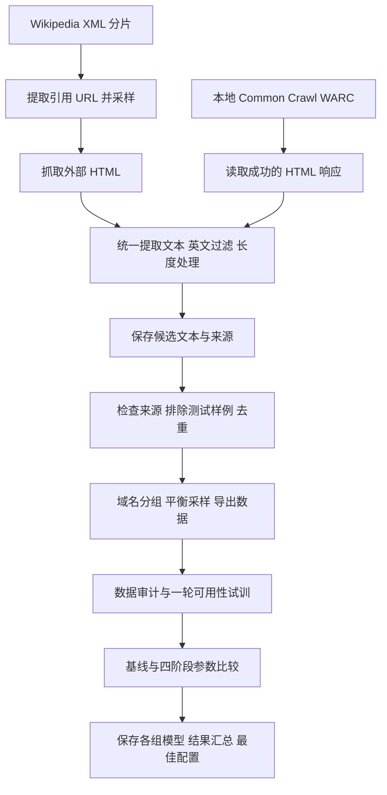

# Assignment 4 质量分类器的数据准备与训练实验

本文记录在本地 Mac 上完成 `quality_classifier` 数据准备、建立基线、批量比较参数和保存模型的全过程。数据处理和训练都在本地执行，无需课程 Modal 权限。

截至 2026 年 11 月 23 日，首轮在 **9,000 条训练样本和 1,000 条验证样本**上完成了 32 组参数实验，最佳验证准确率为 **86.20%**。随后将训练集扩充至 **12,116 条**，保留验证集不变，仅沿用原最佳参数重训一次，验证准确率仍为 **86.20%**。第 1～9 节记录首轮流程和结果，第 10 节说明评价边界，第 11 节记录扩容对照，第 12 节记录已完成的分类接口、当前测试和错误分析。`quality_classifier` 的 a、b 两小节已完成，正式分类接口通过官方样例测试；实际过滤阈值选择及独立测试仍待完成。

## 1 任务目标与标签含义

为大量网页逐篇标注质量成本很高，因此本次采用来源标签作为弱监督信号：

| 标签 | 样本来源 | 设计意图 |
| --- | --- | --- |
| `wiki` | 被 Wikipedia 文章引用的外部英文 HTML 网页 | 提供更可能有信息量、可用作引用的正例 |
| `cc` | 已有 Common Crawl WARC 文件中的英文 HTML 网页 | 提供一般网络网页作为对照 |

正例是**引用链接指向的网页**，不是 Wikipedia 文章正文。Wikipedia XML 分片用于寻找这些链接。

来源标签并不等于人工质量判断：引用网页可能过时或质量较低，CC 中也可能有优秀文章。因此，训练和验证准确率衡量的是模型对这两种来源标签的区分能力，不能直接当作事实真伪判断的准确率。

为了减少模型只学会区分语言、提取格式或网站模板的情况，两类样本使用相同的 HTML 提取器、语言模型、长度规则和文本规范化方式；合并后先去重，再按域名组划分训练集和验证集。

## 2 本地流程与代码结构



| 文件 | 职责 |
| --- | --- |
| [prepare_wiki_references.py](/Users/MacBook/projects/stanford-cs-336/assignment4-data/scripts/prepare_wiki_references.py) | 分片选择、下载校验、流式提取引用和候选采样 |
| [prepare_quality_data.py](/Users/MacBook/projects/stanford-cs-336/assignment4-data/scripts/prepare_quality_data.py) | 正例抓取、CC 负例读取、共享预处理和候选保存 |
| [data_preparation.py](/Users/MacBook/projects/stanford-cs-336/assignment4-data/cs336_data/data_preparation.py) | URL 与文本规范化、哈希校验、去重、域名分组和采样 |
| [export_quality_dataset.py](/Users/MacBook/projects/stanford-cs-336/assignment4-data/scripts/export_quality_dataset.py) | 数据导出、来源审计、泄漏检查和训练可用性检查 |
| [train_quality_classifier.py](/Users/MacBook/projects/stanford-cs-336/assignment4-data/cs336_data/train_quality_classifier.py) | 单次训练、分阶段实验、模型保存、结果汇总和恢复运行 |

本节的质量分类数据由 `prepare_quality_data.py` 的 `make_record()` 完成英文过滤，正负例都经过这个函数，没有调用 WET 准备流程。从 WARC 的 HTML 重新提取负例，也让两类样本使用同一种文本提取方式。第四节开始时，另行补全了 [wet_files.py](/Users/MacBook/projects/stanford-cs-336/assignment4-data/cs336_data/wet_files.py) 的英文判断，用于生成英文 WET 起点；原始资源现可通过 `uv run scripts/prepare_raw_data.py` 统一准备。

## 3 数据来源与采集

### 3.1 根据样本需求选择 Wikipedia 分片

本次使用 `20260501` 的 Wikipedia dump。官方清单中有 70 个文章分片，压缩数据合计约 26.32 GB。根据“已有分片足够时停止扩展”的原则，实际处理了 8 个完整分片：

| 项目 | 数量 |
| --- | ---: |
| 选择的分片 | 8 / 70 |
| 所选压缩源文件合计 | 656,206,753 字节，约 656.21 MB |
| 处理的主命名空间页面记录 | 498,210 |
| 提取的引用 URL 记录 | 1,595,578 |
| 分片采样合并后的唯一候选 URL | 47,581 |

大小按十进制 MB、GB 计算，源文件大小不包含临时下载和缓存。引用 URL 记录允许在不同文章之间重复，不能将其直接理解为唯一链接数量。

脚本默认处理已有完整分片。`--additional-shards 1` 显式增加一个分片，新增分片按大小从小到大选择；只有 `--all-shards` 才请求全量。因此，这批数据不是对整个 Wikipedia 的均匀页面抽样。

### 3.2 下载校验与引用提取

脚本缓存官方 `dumpstatus.json`，确认文章 dump 任务已完成，并使用其中的文件大小和 SHA-1 检查下载结果。下载先写入 `.part`，支持 HTTP Range 续传；只有大小和哈希都匹配后才发布为最终文件。服务器不支持续传时重新写入，避免错误拼接。请求失败最多尝试四次。

此前目录请求遇到过 403。本次使用明确的 User-Agent 并读取结构化清单后请求成功，这属于本机实际排障结果，不是对所有 403 的通用解决办法。

XML 使用 `bz2.open` 和 `ElementTree.iterparse` 流式读取，只处理 `ns=0` 的页面，逐页释放元素。引用提取从有正文的 `<ref>…</ref>` 中寻找 HTTP(S) URL，处理命名引用、多行内容和 HTML 实体，并排除注释、字面内容区域、Wikipedia 自身链接及带账号密码的 URL。

自闭合引用 `<ref name="example" />` 没有新正文，需要避免将后面的普通文章链接误识别为引用。相关边界问题已加入回归测试，当前解析版本为 3；它仍是规则提取器，可能遗漏其他 MediaWiki 引用表达方式。

每个 URL 使用种子 336 计算稳定的 SHA-256 优先级，每个分片保留优先级最小的 6,000 个不同链接作为抓取候选。完整 URL 列表也会保留。固定分片限额使抽样可重现且内存有界，但不同大小分片的抽样比例并不相同。

每个分片的完成记录包含源文件标识、解析版本、样本数量和产物哈希。汇总清单中的 `complete=true` 表示所选分片处理完成，`full_dump=false` 表示未获取全部 dump，URL 文件名也明确包含 `subset`。

### 3.3 正例抓取与失败处理

引用链接通过 URL、robots、响应类型和文本检查后，才可能成为正例候选。失效链接、访问错误和过滤失败只记录原因，不作为正例。

抓取使用线程池在不同网站之间并发，同一可注册域名串行访问，遵守可读取到的 `crawl-delay`，每次至少等待 0.2 秒。重定向手动处理，每到一个新目标重新检查访问规则，最多进行六次获取循环。

| 约束 | 设置 |
| --- | --- |
| 协议与显式端口 | HTTP(S)，80 或 443 |
| 响应内容 | HTML，响应体最多 5 MiB |
| 常规请求超时参数 | 12 秒 |
| robots 请求超时参数 | 8 秒 |
| 读取过程耗时检查 | 每读一块后检查是否超过 40 秒 |
| 抓取阶段的正例域名上限 | 每个最终域名最多接收 25 条 |

robots 返回 404 时按允许处理；明确禁止或无法可靠读取时跳过。目标 URL 需要解析到公网地址，直连后还检查实际对端；显式配置的传输代理被视为受信任连接。

本机曾出现大量线程停留在系统 `getaddrinfo` 的情况，因此增加 `--dns doh`：通过 Google Public DNS 的 HTTPS 接口进行地址预检查，查询超时六秒，缓存最长 60 秒，并禁用客户端子网披露。它不修改系统 DNS，底层 HTTP 连接或代理仍可能自行解析地址。上述超时设置也不构成整个抓取任务的统一硬时限。

通过过滤的正例保留原始与最终 URL、引用文章、源分片、抓取时间及 HTML SHA-256。HTML 以内容哈希命名并压缩缓存，采用临时文件写入后替换；复用前验证内容，损坏缓存可修复。

默认抓取目标 6,500 条是候选数量，预留去重和划分损耗。本次在候选足以成功导出目标数据后停止抓取。脚本没有自动循环“扩展分片—抓取—尝试导出”的调度器，停止决定依据实际导出结果作出。

### 3.4 Common Crawl 负例

负例来自本地两个已有 WARC 文件，逐条读取 `response` 记录，仅保留 HTTP 200、HTML 内容、有效 HTTP(S) URL 且未超过大小限制的响应，然后进入共享预处理。

| 来源 | 检查的 response 记录 | 通过处理的负例候选 |
| --- | ---: | ---: |
| [example.warc.gz](/Users/MacBook/projects/stanford-cs-336/assignment4-data/local-shared-data/CC/example.warc.gz) | 20,153 | 4,584 |
| [另一份 CC WARC](/Users/MacBook/projects/stanford-cs-336/assignment4-data/local-shared-data/CC-MAIN-20250417135010-20250417165010-00065.warc.gz) | 27,824 | 6,654 |
| 合计 | 47,977 | 11,238 |

负例保留来源文件路径、SHA-256、WARC 记录 ID 和抓取日期。只有完整扫描结束才标记来源完成，导出时再次核对。这里的负例仅来自这两个分片，不是对整个 Common Crawl 的全局均匀抽样。

## 4 统一预处理与数据集划分

### 4.1 对两类样本执行相同的处理

`make_record()` 复用已有 [HTML 文本提取器](/Users/MacBook/projects/stanford-cs-336/assignment4-data/cs336_data/extract_text.py)，依次执行：

1. 尝试 UTF-8 解码，必要时检测编码，使用 Resiliparse 提取文本。
2. 将控制字符、换行和连续空白规范化，移除可能被解释为标签的 `__label__…` 片段。
3. 要求至少 50 个按空白分隔的词。
4. 使用 `lid.176.bin` 检查前 50,000 个字符，要求最高预测为英文且分数不低于 0.7。
5. 超过 50,000 字符时截断，并回退到最后一个空格，保存文本摘要、长度和语言分数。

语言阈值 0.7 只用于英文筛选，与网页质量分数或最终质量阈值无关。由于语言预测先于最后的词边界回退，最终数据审计会对实际导出的文本重新识别语言。

提取结果可能保留导航和页脚。训练文本只额外加入来源标签，URL 等元数据保存在旁路文件中；但网页本身的站点名称和链接文字仍可能进入提取文本。

### 4.2 保存候选与处理进度

候选保存在 [examples.sqlite3](/Users/MacBook/projects/stanford-cs-336/assignment4-data/local-shared-data/quality/examples.sqlite3)，使用 WAL 模式：

| 表 | 用途 |
| --- | --- |
| `examples` | 以 `(label, url)` 为主键保存文本和来源，避免同类同 URL 重复插入 |
| `attempts` | 保存已尝试 URL、结果类别和详细原因，重启时跳过已尝试链接 |
| `completed_sources` | 保存完整处理过的 CC 文件及其哈希和统计 |

正例抓取逐结果提交，CC 扫描定期提交并在结束时写入完成标记。失败 URL 默认也会跳过，所以恢复运行不代表自动重试所有网络失败。数据库与 HTML 缓存不是一个跨文件事务，完整性以最终记录和校验为准。

### 4.3 检查来源并排除测试内容

导出前，正例的原始请求 URL 必须属于当前校验通过的引用候选集合，负例必须属于已完成且哈希一致的 CC 来源。本次排除了 1 条已不属于当前引用候选集合的历史记录。

已有质量测试文本的原始、规范化及截断表示也会被排除，避免长测试样例截断后绕过全文摘要检查。这覆盖已知表示，不保证识别所有改写版本。

### 4.4 先去重，再划分

在全部候选上依次进行三层去重：

- **URL 去重**：同时考虑原始请求 URL 和最终 URL。
- **精确文本去重**：大小写折叠、提取词字符序列并重新连接，再计算 SHA-256。
- **近重复检测**：使用连续五词片段、64 个 MinHash 分量、16 组分桶召回候选，最后确认片段集合的 Jaccard 相似度是否达到 0.8。

Jaccard 相似度是两个片段集合的交集大小除以并集大小。MinHash 用于减少比较次数，可能漏检；实现按稳定顺序保留代表，并未构建全部近重复关系的传递闭包。

重复内容同时出现在两类时优先保留 `wiki`，以减少相同内容获得冲突标签的情况。这是来源标签的冲突处理规则。

| 导出快照中的项目 | 数量 |
| --- | ---: |
| 进入去重的候选 | 16,618 |
| 移除的重复 URL | 1 |
| 移除的精确重复 | 89 |
| 移除的近重复 | 99 |
| 去重后候选 | 16,429 |

抓取日志中的 `ok` 次数不是最终唯一文档数，不能与这里的导出快照直接混用。

### 4.5 按域名组划分并平衡类别

使用 `tldextract` 获取可注册域名，并考虑私有后缀。原始 URL 与最终 URL 的域名通过并查集合并，重定向关联的域名必须留在同一组。

域名组使用种子 336 的稳定哈希分区，约 10% 进入验证候选池。每个类别在每个域名组中最多保留 25 条，再按稳定顺序选择并打乱：

| 集合 | wiki | cc | 合计 |
| --- | ---: | ---: | ---: |
| 训练集 | 4,500 | 4,500 | 9,000 |
| 验证集 | 500 | 500 | 1,000 |

任意集合或类别候选不足时导出报错，不通过移动同站点页面或改变比例凑数。每类 5,000 条是本次本地基线的规模选择。固定候选和配置能够重现选择结果，但重新抓取网页受内容变化和并发顺序影响，不保证重新运行整个流程得到逐字节相同的文件。

## 5 数据审计与训练环境检查

### 5.1 最终数据产物

数据位于 [quality/dataset](/Users/MacBook/projects/stanford-cs-336/assignment4-data/local-shared-data/quality/dataset)。`train.txt` 和 `valid.txt` 使用 UTF-8，每行一个 fastText 标签和一篇规范化文本；对应的 `train.jsonl.gz`、`valid.jsonl.gz` 按行保留完整来源。

[manifest.json](/Users/MacBook/projects/stanford-cs-336/assignment4-data/local-shared-data/quality/dataset/manifest.json) 保存配置、数量、分布和产物哈希，[audit.json](/Users/MacBook/projects/stanford-cs-336/assignment4-data/local-shared-data/quality/dataset/audit.json) 保存检查结果。产物通过临时文件逐个替换，单文件替换是原子的，整个目录不是一个事务。

审计重新读取最终数据，核对文本与元数据对齐、类别数量、长度、语言预测、来源、哈希、域名隔离和重复情况。本次结果如下：

| 检查 | 结果 |
| --- | ---: |
| 重新识别语言的文本 | 10,000 条 |
| 核验原始 HTML 的正例 | 5,000 条 |
| 核验的 CC 来源与 Wikipedia 分片 | 2 个 / 8 个 |
| 原始及最终 URL 涉及的不同域名 | 7,587 个 |
| 训练与验证域名交叉 | 0 |
| 精确重复、当前方法检出的近重复 | 均为 0 |
| 已知测试文本表示的重叠 | 0 |
| 最终清单 ready | true |

审计会重读产物，但复用了部分预处理和去重辅助函数，因此不是完全独立的第二套算法。`ready` 要求数据检查成功，并有与当前产物和模型哈希匹配的可用性检查记录。首轮通过试训完成检查；扩容时可用 `--readiness-model` 重新评估已有模型，不额外训练。旧检查记录不能直接复用于变化后的数据。

### 5.2 一轮试训与 NaN 排查

正式调参前，先用 epoch=1、dim=32、wordNgrams=2、minCount=2、bucket=100000 做可用性试训，验证真实数据能够训练、保存、重新加载并评估。该诊断模型 `readiness-smoke.bin` 的验证准确率是 **55.20%**，它与后面的正式基线和最佳模型是不同实验。

最初 `thread=4` 时出现 `Encountered NaN`。检查本机 fastText 0.9.3 源码及训练前权重后发现：初始化按固定十等份分配任务，四线程未覆盖全部权重，十线程还需考虑整数除法的尾部。改用十二线程后，初始权重均处于预期范围，同一语料可以正常训练。

因此本次所有正式实验固定 `thread=12`。这是针对本机安装构建的处理，不意味着其他版本都必须采用相同线程数。

## 6 从基线到批量实验

### 6.1 固定数据和评价方式

每组实验都从头训练，只用训练集更新参数，然后分别评估训练集和验证集。当前每条样本只有一个标签、每次只预测一个标签，因此 fastText 返回的整体 **P@1 = R@1 = 准确率**。它们不等于 `wiki` 类别单独的 precision 和 recall。

正式基线使用 epoch=5、lr=0.1、dim=64、wordNgrams=2、minCount=2、bucket=200000；固定项为 softmax、thread=12、seed=336，字符特征关闭。

早先手动运行得到训练 76.57%、验证 74.20%。批量实验重新训练同一配置得到 76.62%、74.30%。多线程训练可能存在小幅波动，后面的参数比较统一使用批量实验记录中的结果。

### 6.2 分阶段比较参数

先比较学习率与训练轮数，再比较特征，最后检查更大容量和字符特征是否有帮助。每阶段按验证准确率选择候选，同分时按实验 ID 稳定排序。

| 阶段 | 比较内容 | 选择规则 | 本次新增训练组数 |
| --- | --- | --- | ---: |
| A | epoch：5、10、20 × lr：0.1、0.3、0.5 | 保留前两组进入 B | 9 |
| B | 对 A 的两组分别比较 wordNgrams：1、2、3 × minCount：1、2、5 | 保留前两组进入 C | 16 |
| C | 对 B 的两组分别比较 dim：64、128 × bucket：200000、1000000 | 取最好一组进入 D | 6 |
| D | 对 C 的最好配置比较字符特征关闭与 minn=3、maxn=6 | 完成比较 | 1 |
| 合计 | 按完整参数记录去重 | 保存全部结果 | 32 |

B、C、D 的候选分别有 18、8、2 组，其中各有 2、2、1 组已经训练过，直接复用。因此实际新增组数是 9 + 16 + 6 + 1。这是分阶段搜索，没有穷举所有参数的笛卡尔积，也尚未做多个随机种子的稳定性比较。

### 6.3 运行器如何保存与恢复

`train_quality_classifier()` 负责一次训练、评估和模型保存，返回指标而不是长期持有模型对象。`ExperimentRunner` 管理实验记录，`run_batch()` 组织四阶段搜索。

实验 ID 来自完整参数的稳定哈希。每完成一组就保存模型和 JSON，并更新 CSV 与最佳记录。再次运行会核对训练与验证文件的哈希、fastText 版本及模型哈希，复用匹配的成功结果；模型缺失或损坏则重跑。

已有失败记录默认跳过，使用 `--retry-failed` 才显式重试。这样在设置每次运行数量上限时，持续失败的前一组不会反复占用额度、挡住后续实验。单组失败会留记录并继续；整个阶段都失败时停止，因为无法选择下一阶段参数。同一输出目录使用写锁，防止多个进程同时写入。

终端输出已经精简：新实验打印关键参数和两份准确率，不逐条打印复用信息；结束时只显示成功、失败和本次运行数量、最佳准确率以及 CSV 路径。完整参数和所有实验结果仍保留在文件中。

## 7 各阶段的实际结果

以下数值来自 [results.csv](/Users/MacBook/projects/stanford-cs-336/assignment4-data/local-shared-data/quality/experiments/results.csv)，没有将不同运行批次的成绩混合排名。

### 7.1 学习率和轮数带来了主要提升

A 阶段固定 dim=64、wordNgrams=2、minCount=2、bucket=200000，字符特征关闭：

| epoch | lr | 训练准确率 | 验证准确率 |
| ---: | ---: | ---: | ---: |
| 5 | 0.1 | 76.62% | 74.30% |
| 5 | 0.3 | 89.82% | 82.80% |
| 5 | 0.5 | 94.43% | 84.20% |
| 10 | 0.1 | 85.27% | 81.30% |
| 10 | 0.3 | 96.94% | 84.50% |
| 10 | 0.5 | 98.97% | 85.00% |
| 20 | 0.1 | 94.43% | 83.40% |
| 20 | 0.3 | 99.71% | **85.10%** |
| 20 | 0.5 | 99.89% | 85.00% |

本轮中，提高学习率和训练轮数明显改善了验证结果，但收益没有一直随数值增大。epoch=20、lr=0.5 的训练准确率更高，验证准确率却略低于 lr=0.3。

进入 B 的两组是 `(20, 0.3)` 和 `(20, 0.5)`。后者与 `(10, 0.5)` 验证同为 85.00%，由实验 ID 的稳定顺序选中，并不表示它已被证明更优。

### 7.2 单词特征与低频词过滤进一步改善结果

B 阶段比较词 n-gram 长度与最低词频。下面是 epoch=20、lr=0.3 这一分支的验证准确率；其他参数沿用 A 阶段：

| wordNgrams | minCount=1 | minCount=2 | minCount=5 |
| ---: | ---: | ---: | ---: |
| 1 | 85.70% | 85.30% | **86.20%** |
| 2 | 85.10% | 85.10% | 85.30% |
| 3 | 84.90% | 85.00% | 85.00% |

本轮最佳组合是 wordNgrams=1、minCount=5。lr=0.5 分支最高为 85.60%，所以进入 C 的两组都来自 lr=0.3，分别是单词特征下的 minCount=5 和 minCount=1。

这些结果支持在当前数据上保留更简单的单词特征。较长短语或稀有词可能包含模板和来源噪声，但本轮实验没有直接测量这一机制，不能仅凭准确率就确定原因。

### 7.3 增加向量维度没有继续提升

C 阶段在 B 的两组候选上比较 dim 和 bucket。以下展示 minCount=5 分支，其余固定为 epoch=20、lr=0.3、wordNgrams=1、字符特征关闭：

| dim | bucket 参数值 | 训练准确率 | 验证准确率 |
| ---: | ---: | ---: | ---: |
| 64 | 200000 | 99.40% | **86.20%** |
| 64 | 1000000 | 99.43% | 85.80% |
| 128 | 200000 | 99.38% | 85.40% |
| 128 | 1000000 | 99.46% | 85.70% |

第一行复用了 B 阶段的模型。minCount=1 分支也没有超过 86.20%，因此继续保留原来的 dim=64 配置。

这里有一个重要解释边界：**wordNgrams=1 且字符特征关闭时，fastText 不使用 n-gram 桶**。因此，仅 bucket 不同的行虽然参数记录不同，实际特征配置等效，其成绩差异不能归因于哈希碰撞减少，更可能反映多线程训练波动。本次 C 阶段并未有效检验“启用 n-gram 时扩大 bucket”的收益。

### 7.4 字符特征在本轮没有带来提升

D 阶段在当前最佳配置上只改变字符特征设置：

| 字符特征 | 训练准确率 | 验证准确率 |
| --- | ---: | ---: |
| 关闭，minn=0、maxn=0 | 99.40% | **86.20%** |
| 启用，minn=3、maxn=6 | 94.62% | 84.50% |

因此最终保留关闭字符特征的模型。这个结论仅适用于本次沿用其他超参数的对照，不代表字符特征在重新调参或其他数据上一定无效。

## 8 首轮最佳参数与模型

本次 32 组记录中，验证准确率最高的配置如下。“最佳”限定于这次搜索范围和这份验证集。

| 参数 | 选定值 |
| --- | ---: |
| epoch | 20 |
| lr | 0.3 |
| dim | 64 |
| wordNgrams | 1 |
| minCount | 5 |
| bucket | 200000，本配置下不参与特征表示 |
| loss | softmax |
| thread | 12 |
| minn / maxn | 0 / 0 |
| seed | 336 |

对应训练准确率 **99.40%**，验证准确率 **86.20%**。相对本轮基线 74.30%，验证准确率提高 **11.90 个百分点**；训练与验证的差距也扩大到 **13.20 个百分点**。这表明验证表现改善了，但训练集记忆和泛化差距仍值得关注。

模型可以从 [最佳模型文件](/Users/MacBook/projects/stanford-cs-336/assignment4-data/local-shared-data/quality/experiments/models/6f8b29d19296ca3f05af.bin) 加载，完整参数、指标和哈希位于 [best.json](/Users/MacBook/projects/stanford-cs-336/assignment4-data/local-shared-data/quality/experiments/best.json)。无需再用一轮诊断模型作为后续分类器。

本次检查了全部 32 份模型的哈希、参数与 CSV/JSON 对应关系和评估样本数，并重新加载最佳模型复算了两份准确率。完整恢复运行没有新增训练，所有模型修改时间保持不变。

## 9 运行方式与结果文件

### 9.1 启动或继续实验

默认运行四阶段搜索：

```bash
uv run --project /Users/MacBook/projects/stanford-cs-336/assignment4-data /Users/MacBook/projects/stanford-cs-336/assignment4-data/cs336_data/train_quality_classifier.py
```

现有结果完整时，该命令校验并复用记录，不重新训练。要得到一次新的独立运行，应指定新的输出目录。

| 选项 | 用途 |
| --- | --- |
| `--mode epochs --epochs 5 10 20` | 只比较轮数 |
| `--mode baseline` | 单次基线，固定 epoch=5、lr=0.1 |
| `--epochs 5 10 20` | 设置 search 或 epochs 模式的轮数列表 |
| `--learning-rates 0.1 0.3 0.5` | 设置 search 模式的学习率列表 |
| `--max-experiments 3` | 本次最多新尝试三组，复用不计数，失败尝试计数 |
| `--retry-failed` | 重试已有失败配置 |
| `--seed 337` | 设置种子；比较随机性时同时指定独立输出目录 |
| `--output-dir` | 指定结果目录 |
| `--train`、`--valid` | 指定数据文件 |

默认路径按脚本位置确定，不依赖启动目录。实验逐组执行，每组内部使用 12 个线程。Ctrl+C 后已完成记录保留，未完成的一组需要重新训练。

数据路径、内容或 fastText 版本与已有清单不一致时，脚本拒绝混用结果。修改训练函数行为后也应使用新目录，因为恢复判断不包含脚本源码哈希。

### 9.2 查看结果与追踪来源

结果位于 [quality/experiments](/Users/MacBook/projects/stanford-cs-336/assignment4-data/local-shared-data/quality/experiments)，本次模型合计约 4.38 GB，处于 Git 忽略的数据目录中。

| 文件 | 内容 |
| --- | --- |
| `results.csv` | 所有组的参数、状态、样本数、准确率、耗时、模型路径和错误；成功组按验证准确率降序排列 |
| `records/<实验ID>.json` | 单次实验的完整记录与模型 SHA-256；stage 标识首次训练所在阶段 |
| `models/<实验ID>.bin` | 对应模型 |
| `best.json` | 当前目录中验证准确率最高的成功记录 |
| `experiment_manifest.json` | 数据路径、哈希、类别计数、fastText 版本和记录格式版本 |

CSV 的准确率以 0～1 数值保存，终端以百分数显示。批量训练脚本本身只记录整体准确率；后续已单独保存分类别 precision、recall、混淆矩阵和概率损失，见第 12 节。旧的原始基线模型和 `readiness-smoke.bin` 不属于这 32 组结果。

需要查看误分类来源时，可按训练或验证文本的行号找到对应 JSONL 记录，再定位正例 HTML 或负例 WARC 记录。早期 `quality/integration-check` 是小规模流程检查数据，正式实验使用 `quality/dataset`。

### 9.3 必要时复查或重建数据

只审计现有数据可以执行：

```bash
uv run --project /Users/MacBook/projects/stanford-cs-336/assignment4-data /Users/MacBook/projects/stanford-cs-336/assignment4-data/scripts/export_quality_dataset.py audit
```

添加 `--smoke-train` 会重训诊断模型。下面是需要重新准备数据时的分步命令，当前已有数据不必重跑；抓取会联网，默认导出会替换数据产物并重置就绪状态。

```bash
cd /Users/MacBook/projects/stanford-cs-336/assignment4-data

uv run /Users/MacBook/projects/stanford-cs-336/assignment4-data/scripts/prepare_wiki_references.py --existing-only
uv run /Users/MacBook/projects/stanford-cs-336/assignment4-data/scripts/prepare_quality_data.py negatives
uv run /Users/MacBook/projects/stanford-cs-336/assignment4-data/scripts/prepare_quality_data.py crawl --target 6500 --workers 12 --dns doh
uv run /Users/MacBook/projects/stanford-cs-336/assignment4-data/scripts/export_quality_dataset.py export --per-class 5000
uv run /Users/MacBook/projects/stanford-cs-336/assignment4-data/scripts/export_quality_dataset.py audit --smoke-train
```

Wikipedia 提取脚本的默认数据根目录相对于当前目录，因此这里先进入项目目录。需要新增分片时使用 `--additional-shards 1`。更换提取器或过滤规则后，要重新处理来源并生成相应候选，不能只重新导出旧记录；比较不同数据版本时应使用独立目录。

## 10 结果的适用范围与下一步

验证集已用于筛选参数，86.20% 属于开发集成绩。本次每组只记录了一个种子的运行，多线程训练还可能带来波动。验证集有 1,000 条，0.1 个百分点对应一条样本，因此几条样本的差距不足以证明某组参数稳定占优。

数据也存在来源偏差：Wikipedia 只选了 8 个分片，CC 只来自两个 WARC；HTML 可访问性、robots 规则、抓取时间和主题覆盖影响了最终样本。词数统计显示，两类仍不完全匹配：

| 集合与类别 | 最终 URL 的不同域名数 | 文本词数中位数 |
| --- | ---: | ---: |
| 训练 wiki | 2,460 | 1,197 |
| 训练 cc | 4,270 | 746 |
| 验证 wiki | 287 | 1,194 |
| 验证 cc | 474 | 790.5 |

同一集合内两类可以共享域名，这些数量不能直接相加当作全局唯一域名数。统一过滤没有完成主题、长度或模板匹配，模型仍可能利用这些特征；域名隔离和近重复检查降低了泄漏风险，但不能消除所有跨域转载或相似内容。

分类接口已经完成。后续可按需要考虑以下工作；当前不继续训练：

1. 抽查高置信度误分类，区分模型错误和来源标签不准确。
2. 对排名靠前的少量配置使用多个种子重复训练，比较平均表现和波动。
3. 在新的、与训练域名隔离且未参与调参的数据上做最终评价。
4. 根据实际过滤目标选择阈值，比较保留比例、精确率和召回率。

质量分数可以定义为模型对 `wiki` 的预测概率；预测标签的置信度则属于被预测的那个类别。例如预测 `cc` 的分数为 0.9 时，不能把 0.9 当作“高质量分数”。质量阈值需要根据保留量、精确率和召回率选择，与英文过滤的 0.7 阈值无关。

历史上，首轮实验结束时批量运行器的 9 项测试已通过，当时全仓库测试为 41 项通过、4 项失败，见 [首轮测试日志](/Users/MacBook/projects/stanford-cs-336/assignment4-data/local-shared-data/quality/logs/experiment-tests.log)。该日志不是当前完成状态：`test_classify_quality` 现在已通过，当前测试范围与剩余的去重接口见第 12 节。


## 11 固定验证集后的训练集扩容

### 11.1 抓取固定的 6,129 条候选链接

本轮使用已有 8 个 Wikipedia 分片中的未尝试候选，没有下载新分片。开始前保存候选清单及 SHA-256，抓取时使用 `--candidate-file` 固定范围。已记录结果的链接在重启后自动跳过；固定批次不受原来的正例目标数量限制，但仍受每域名最多 25 条正例的收录限制。

6,129 条链接全部有处理结果，其中 1,236 次请求通过正文和英文检查。部分请求重定向到库中已有的最终 URL，因此正例候选库实际净增 **1,189 条**，从 5,554 条增至 6,743 条。失败或跳过不代表网页一定低质量，也不作为负例加入训练。

| 主要结果 | 请求数 |
| --- | ---: |
| 通过正文和英文检查 | 1,236 |
| robots 禁止访问或无法获取规则 | 2,177 |
| HTTP 403 | 640 |
| HTTP 404 | 754 |
| 非英文或英文置信度不足 | 673 |
| 正文过短 | 371 |
| 网站要求抓取间隔超过 60 秒，跳过 | 18 |

这张表只列主要结果，不是完整分类。18 条长间隔链接涉及 527～14,400 秒的站点要求；脚本跳过这些页面，而不是缩短网站要求的间隔。完整结果见 [crawl-summary.json](/Users/MacBook/projects/stanford-cs-336/assignment4-data/local-shared-data/quality/expansion/crawl-summary.json)。

### 11.2 保留旧样本，只增加训练数据

本轮没有再次调用原来的 90%/10% 划分逻辑。`--expand-from` 将旧训练集和验证集作为固定样本：

1. 核对旧数据集清单中的文件哈希，并要求新输出目录不同于旧目录。
2. 新候选的原始域名和重定向域名组成关联组；与现有验证集域名直接或间接关联的候选不进入训练集。
3. 先保留旧样本，再移除新增候选中的 URL 重复、规范化文本重复和 MinHash 检出的近重复，避免新正例替换已有样本。
4. 保留每标签、每域名组最多 25 条的上限，从剩余候选中加入等量正负例。
5. 原训练记录原样保留在新训练文件开头；验证文本和压缩元数据文件直接复制，确保字节与哈希完全一致。

| 集合 | 扩容前 | 扩容后 | 新增 |
| --- | ---: | ---: | ---: |
| 训练 wiki | 4,500 | 6,058 | 1,558 |
| 训练 cc | 4,500 | 6,058 | 1,558 |
| 训练合计 | 9,000 | **12,116** | **3,116（34.6%）** |
| 验证合计 | 1,000 | **1,000** | **0** |

新增的 1,558 条正例包含本轮抓取的 **1,108 条**，以及此前已缓存但未进入原数据集的 **450 条**。新增负例来自已有的两个 CC WARC 候选库。因此，“训练集净增”既包含本轮新增网页，也包含之前未选用的候选；它不等于成功抓取次数。

扩容数据保存在 [dataset-expanded](/Users/MacBook/projects/stanford-cs-336/assignment4-data/local-shared-data/quality/dataset-expanded)。审计重新检查全部 13,116 条文本、原始来源与文件哈希，确认原 9,000 条训练记录保留、两个验证文件逐字节不变，域名交集、精确重复及当前方法检出的近重复均为 0。审计通过 `--readiness-model` 复用原最佳模型检查加载和预测，没有额外训练一轮诊断模型。

### 11.3 只沿用原最佳参数重训一次

本轮按后续决定取消整批搜索，只运行一组：epoch=20、lr=0.3、dim=64、wordNgrams=1、minCount=5、bucket=200000、loss=softmax、thread=12、minn=0、maxn=0、seed=336。所有参数与首轮最佳记录一致。

| 对照 | 训练样本数 | 训练准确率 | 同一验证集准确率 |
| --- | ---: | ---: | ---: |
| 首轮最佳模型 | 9,000 | 99.40% | 86.20%（862/1,000） |
| 扩容后，同参数重训 | 12,116 | 99.41% | **86.20%（862/1,000）** |

这次训练集增加 34.6%，验证准确率没有提高；不能据此断言增加数据没有价值，但也没有证据宣称这次扩容改善了验证准确率。两份训练准确率来自不同规模的训练集，只作描述；公平对照主要看固定验证集。仍然只有一次运行，且验证集已用于此前调参。

新模型和结果保存在独立的 [experiments-expanded](/Users/MacBook/projects/stanford-cs-336/assignment4-data/local-shared-data/quality/experiments-expanded)，没有覆盖旧模型。该目录仅有一组实验；其中 `best.json` 表示本目录唯一结果，不表示又进行了一轮最优参数搜索。

- [新模型](/Users/MacBook/projects/stanford-cs-336/assignment4-data/local-shared-data/quality/experiments-expanded/models/6f8b29d19296ca3f05af.bin)
- [本轮参数与指标](/Users/MacBook/projects/stanford-cs-336/assignment4-data/local-shared-data/quality/experiments-expanded/best.json)
- [扩容前后对照记录](/Users/MacBook/projects/stanford-cs-336/assignment4-data/local-shared-data/quality/expansion/comparison.json)

恢复本次单组实验时，显式使用旧最佳参数，不能直接运行默认四阶段搜索：

```bash
cd /Users/MacBook/projects/stanford-cs-336/assignment4-data
uv run python - <<'PYTHON'
import json
from pathlib import Path
from cs336_data.train_quality_classifier import run_batch

root = Path('/Users/MacBook/projects/stanford-cs-336/assignment4-data/local-shared-data/quality')
params = json.loads((root / 'experiments/best.json').read_text())['params']
run_batch(
    root / 'dataset-expanded/train.txt',
    root / 'dataset-expanded/valid.txt',
    root / 'experiments-expanded',
    mode='baseline',
    base_params=params,
)
PYTHON
```

结果完整时只校验和复用，不再次训练。这里的 `mode='baseline'` 代表单组运行，实际参数由 `base_params` 显式覆盖，不是默认的 epoch=5、lr=0.1。

扩容完成时，数据准备与批量运行器的相关测试合计 **29 项通过**。新模型已重新加载并复算训练与验证准确率，结果与保存记录一致。之后分类适配器也已接通，当前状态见第 12 节。


## 12 分类接口与当前验证状态

### 12.1 b 小节的接口约定

[quality_classify.py](/Users/MacBook/projects/stanford-cs-336/assignment4-data/cs336_data/quality_classify.py) 提供 `classify_quality(text)`，通过 [run_classify_quality](/Users/MacBook/projects/stanford-cs-336/assignment4-data/tests/adapters.py:41) 接入作业。输入是提取后的正文字符串，返回 `(label, confidence)`：标签为 `wiki` 或 `cc`，置信度是对应预测标签的 Python `float`，范围为 `[0, 1]`。例如 `('cc', 0.9)` 表示对 `cc` 标签的置信度，不是高质量概率。

接口使用扩容后选定的模型。路径由当前 Python 文件定位项目根目录，模型在模块首次导入时加载，后续调用复用。推理按以下约定处理文本：

1. 复用 `normalize_text`，统一控制字符和空白，移除 `__label__…` 片段。
2. 规范化后没有正文时抛出 `ValueError`，包括空字符串、纯空白或仅有标签片段的输入。
3. 超过 50,000 字符时，沿用数据准备中的前缀截断和词边界回退规则；刚好 50,000 字符时不截断。
4. 将模型分数显式转换为 `float`，裁剪到 `[0, 1]`，处理 fastText 可能产生的微小越界。

**handout 要求的是字符串输入、标签与置信度输出、适配器接入和两个样例的 sanity check。** 空输入处理、统一预处理和 50,000 字符截断是本项目的工程约定，不是额外的作业硬性要求。置信度裁剪仅修正数值范围，不等于完成概率校准。

### 12.2 当前测试与尚未完成的部分

当前 [test_quality.py](/Users/MacBook/projects/stanford-cs-336/assignment4-data/tests/test_quality.py) 共 **14 项通过**，包括 7 项分类检查和 7 项 Gopher 检查。分类检查覆盖两个官方样例、返回类型和范围、三种规范化后为空的输入、空白与标签规范化、超长文本的半词截断以及恰好达到长度上限的输入。

通过更新后的分类函数逐条评估固定验证集，结果仍为 **862/1,000，即 86.20%**；全部返回分数符合类型和范围约定，模型文件 SHA-256 未变化。这次修正只涉及推理和文档，没有重新训练。

```bash
cd /Users/MacBook/projects/stanford-cs-336/assignment4-data
uv run pytest /Users/MacBook/projects/stanford-cs-336/assignment4-data/tests/test_quality.py -q
```

为避免触发训练，本次更广的检查排除了 `tests/test_quality_experiments.py`。其余测试结果为 **44 项通过、3 项失败**。失败均由尚未完成的作业去重适配器抛出 `NotImplementedError`：

- `test_exact_line_deduplication`
- `test_minhash_deduplication_exact_duplicates`
- `test_minhash_deduplication_fuzzy_duplicates`

这些接口属于后续去重问题。数据准备中已有的去重辅助函数，不代表对应作业接口已经实现。上述结果也不是本次全套测试全部通过的声明。

### 12.3 已保存的错误分析

已有 [error-analysis.json](/Users/MacBook/projects/stanford-cs-336/assignment4-data/local-shared-data/quality/expansion/error-analysis.json) 记录新旧模型在同一验证集上的比较，[validation-errors.jsonl](/Users/MacBook/projects/stanford-cs-336/assignment4-data/local-shared-data/quality/expansion/validation-errors.jsonl) 保存新模型的 138 条错误及原文、URL、预测分数和旧模型是否预测正确。

| 指标 | 原模型 | 扩容模型 |
| --- | ---: | ---: |
| 准确率 | 86.20% | 86.20% |
| wiki 精确率 | 86.35% | 85.35% |
| wiki 召回率 | 86.00% | 87.40% |
| Log loss，越低越好 | 0.4644 | 0.4343 |
| Brier score，越低越好 | 0.1173 | 0.1092 |

扩容模型修正了 23 条旧错误，也新增了 23 条错误，另有 115 条两个模型都预测错误。当前选择扩容模型，是考虑其较低的概率损失；它没有在所有指标上胜出，也不代表获得了独立测试集上的最优结论。后续人工归因、独立质量评估和过滤阈值选择仍待开展。
